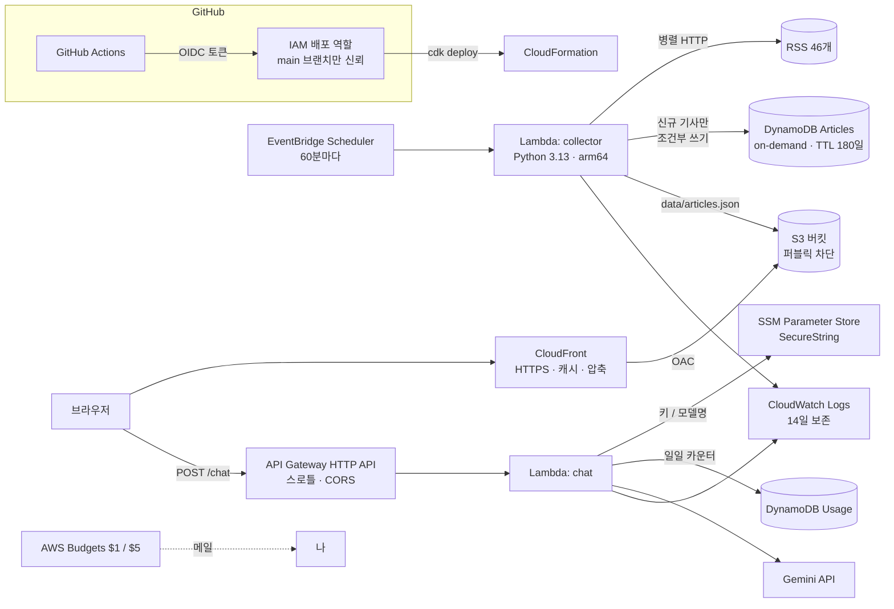

# AI 뉴스 대시보드 (AWS 서버리스)

국내 IT·AI 매체와 정부·공공기관 RSS 46개를 **매시간** 모아 **업종 / 주제 / 기업**별로 분류해 보여주는 개인 학습용 대시보드.
AI 직무 준비 과정에서 "AWS 서비스를 직접 설계하고, 코드(IaC)로 배포하고, CI/CD까지 구성했다"는 것을 보여주기 위한 포트폴리오 프로젝트입니다.

- 서버 관리 없음 (Lambda + S3 + CloudFront + DynamoDB), VPC·NAT 없음, **월 약 $0.1 이하**
- 인프라 전체를 **AWS CDK(Python)** 로 정의, **GitHub Actions + OIDC** 로 키 없이 배포
- 분류는 **키워드 규칙 기반**(LLM 호출 없음), 분류 근거를 함께 저장해 오분류를 추적
- 요약은 **기사 본문 전체에서 핵심 문장 3개를 고르는 추출 요약**(TF-IDF TextRank + 제목·위치 가중치 + MMR, LLM 없음). 본문은 요약에만 쓰고 저장하지 않음
- 여러 매체의 같은 기사는 **제목 유사도로 한 카드로 묶고**, 기사 제목에서 뽑은 **핵심 이슈 순위**를 표시
- 우측 하단 **학습 도우미 챗봇**: 보고 있는 기사의 용어·배경을 Gemini(무료 티어)로 설명

---

## 아키텍처



### 서비스별 역할과 선택 이유

| 서비스 | 역할 | 왜 이걸 골랐나 |
|---|---|---|
| **S3** | 정적 사이트 파일 + 최신 스냅샷 `data/articles.json` | 저장한 만큼만 과금. 퍼블릭 접근은 막고 CloudFront만 읽게 함 |
| **CloudFront** | HTTPS 입구, 캐시, gzip/brotli 압축 | S3 웹사이트 호스팅은 HTTPS 불가. OAC로 버킷 비공개 유지. 상시 무료 월 1TB |
| **EventBridge Scheduler** | 60분마다 수집 Lambda 실행 | 서버 없는 cron. 월 1,400만 회 무료 |
| **Lambda** (collector, chat) | 수집·분류 / 챗봇 프록시 | 실행 시간만 과금 → 대기 비용 0. arm64로 x86 대비 약 20% 저렴 |
| **DynamoDB** (on-demand) | 기사 누적 저장, 챗봇 일일 카운터 | 요청량이 작고 들쭉날쭉 → 프로비저닝보다 on-demand가 단순·저렴 |
| **API Gateway HTTP API** | 챗봇 엔드포인트 | 스테이지 스로틀과 CORS 기본 제공 (아래 트레이드오프 참고) |
| **SSM Parameter Store** | Gemini 키(SecureString), 모델명 | 표준 파라미터 무료, KMS 암호화. Secrets Manager는 유료라 제외 |
| **CloudWatch Logs** | 구조화 로그 | 로그 그룹을 직접 만들어 보존 14일 강제 (기본값은 영구 보관) |
| **AWS Budgets** | 월 $1 / $5 초과 예상 시 메일 | 과금 사고 조기 발견 |
| **IAM + GitHub OIDC** | 배포 권한 | 장기 액세스 키 없이 실행마다 1시간짜리 임시 자격 증명 |

---

## 설계 결정과 트레이드오프

**1. 프론트는 DB가 아니라 S3의 JSON 스냅샷을 읽는다**
- 수집 Lambda가 매시간 최근 7일치 기사를 `articles.json`(약 2MB, 압축 후 약 400KB)으로 만들어 S3에 올리고, CloudFront가 캐시해서 전달한다.
- 조회용 API·Lambda가 필요 없어 **방문자가 늘어도 DynamoDB 읽기 비용이 0**이다.
- 대신 데이터는 최대 1시간(수집 주기) + 5분(캐시) 늦을 수 있다. 뉴스 대시보드에는 충분하다.
- CloudFront 무효화는 월 1,000건 이후 유료라, 매시간 무효화하지 않고 `Cache-Control: max-age=300`을 쓴다.

**2. DynamoDB 키 설계**
- **PK `id` = sha256(정규화한 link) 앞 16자리.** 정규화는 scheme 무시, `www.` 제거, `utm_*` 같은 추적 파라미터와 끝 슬래시 제거. guid가 없는 매체가 많아 **link를 중복 판정 기준**으로 삼았다.
- 같은 기사는 항상 같은 키가 나오므로 `attribute_not_exists(id)` 조건부 쓰기로 **DB 수준에서 중복을 막는다.**
- **GSI `byDay` (PK `day` = KST 날짜, SK `publishedAt`)**: "최근 N일" 조회를 Scan 없이 날짜별 Query로 처리한다. 스냅샷이 사라졌을 때 복구용.
- **TTL `expiresAt` = 180일**: 오래된 기사를 무료로 자동 삭제해 저장 비용이 계속 쌓이지 않게 한다.
- **쓰기 비용 최적화**: 매번 약 2,400건을 받지만, 직전 스냅샷의 id 집합으로 메모리에서 먼저 거르고 **신규 기사만 쓴다.** 전부 쓰면 월 약 170만 건(약 $2), 신규만 쓰면 월 수만 건(몇 센트)이다.

**3. 챗봇 엔드포인트: Lambda Function URL 대신 HTTP API**
- Function URL은 무료지만 자체 스로틀이 없어 Lambda 예약 동시성에 기대야 한다.
- 그런데 신규 계정은 Lambda 동시 실행 한도가 10인 경우가 많고, 이때는 예약 동시성을 설정할 수 없다.
- HTTP API는 **스테이지 스로틀(초당 1회, 버스트 5)과 CORS**를 기본 제공하고, 100만 건당 약 $1이라 이 규모에서는 사실상 무료다.
- REST API의 usage plan은 API 키를 프론트에 넣어야 해서 의미가 없으므로 제외했다.
- 남용 방지는 여러 겹: 스로틀 → CORS(내 CloudFront 도메인만) → Lambda의 Origin 재확인 → 입력 1,000자 제한 → **DynamoDB 원자적 카운터로 일일 200회 상한** → 공급자 429는 친절한 메시지로 변환.

**4. IaC: SAM 대신 CDK(Python)**
- CloudFront+OAC, Budgets, OIDC 역할까지 정의해야 해서 Lambda 중심인 SAM보다 CDK의 L2 구성 요소가 훨씬 짧다.
- `cdk diff`로 변경을 미리 보고 배포한다. Lambda 코드·테스트와 같은 Python으로 통일했다.

**5. Lambda에 외부 라이브러리를 넣지 않는다**
- RSS 파싱은 표준 라이브러리 XML 파서로 처리한다(매체별 형식 차이는 직접 정규화).
- 설정 YAML은 배포 시점에 JSON으로 바꿔 함께 올린다.
- 결과: **Docker 빌드가 필요 없고**, 패키지가 작아 콜드 스타트가 빠르다. 대신 feedparser 같은 라이브러리의 엣지 케이스 처리는 직접 테스트로 메웠다(`tests/test_parse.py`).

**6. 수집·분류 로직은 순수 모듈**
- `collector/` 패키지는 AWS를 모른다. Lambda 핸들러는 S3/DynamoDB 입출력만 담당한다.
- 그래서 `python scripts/run_local.py`로 **AWS 없이 로컬에서 같은 코드로 수집·분류**하고 리포트를 볼 수 있다.

**7. 실패에 강하게**
- 피드별 타임아웃 10초 + 5xx/네트워크 오류는 1회 재시도. 16개 스레드로 병렬 수집한다.
- 한 피드가 실패해도 나머지는 계속 진행하고, 실패는 `feed_failed` 구조화 로그로 남긴다.
- **피드 성공률이 50% 미만이면 스냅샷을 덮어쓰지 않는다**(일시적 네트워크 장애로 빈 화면이 되는 것 방지).

**8. 분류는 LLM이 아닌 키워드 규칙**
- 비용 0, 결과가 결정적이고 설명 가능하다. 다중 라벨을 지원한다.
- 매칭 근거(`why`)를 저장해 화면에서 "🔍 분류 근거"로 오분류 원인을 바로 확인하고 사전(YAML)을 고친다.
- 영문 키워드는 앞뒤가 영문·숫자가 아닐 때만 매칭(`KB` ≠ `KBS`). `exclude`로 `메타버스`→메타, `애플리케이션`→애플 같은 오매칭을 막는다.
- 현재 업종 미분류는 약 27%이고, 대부분 음식·건강·부동산처럼 IT와 무관한 기사다.

**9. 저작권·약관**
- 저장하는 건 제목, 링크, 발행시각, 매체, 분류, **200자로 자른 요약**뿐이다. 본문은 저장하지 않고 항상 원문 링크로 연결한다.
- 챗봇에는 기본적으로 **제목과 링크만** 보낸다. 요약 전송은 설정에서 켜야 한다(일부 매체 RSS에 "AI 학습·활용 금지" 문구가 있음).
- 네이버 검색 API는 약관상(AI 요약 금지 등) 사용하지 않는다.

**10. 알려진 한계와 개선 과제**
- CDK bootstrap의 CloudFormation 실행 역할은 기본 `AdministratorAccess`다. `--cloudformation-execution-policies`로 범위를 좁힐 수 있다.
- 버킷 자동 삭제용 CDK 내장 Lambda는 로그 보존 기간을 지정할 수 없다(배포·삭제 때만 실행되어 로그는 거의 없음).
- 기사가 빨리 밀리는 일부 피드(약 1시간 안에 30건 이상)는 1시간 수집에서도 일부를 놓칠 수 있다.
- 읽음·북마크는 기기별(localStorage)이다 → 2차: Cognito 로그인 + DynamoDB 동기화.

---

## 보안 / 가드레일 체크리스트

- [x] VPC·NAT Gateway 없음, Lambda는 VPC 밖
- [x] Secrets Manager·OpenSearch·상시 켜지는 리소스 없음
- [x] CloudWatch 로그 보존 14일 (`cdk.json`의 `logRetentionDays`)
- [x] IAM 최소 권한: collector는 `PutItem`/`Query`와 `data/articles.json` 읽기·쓰기만, chat은 `UpdateItem`과 파라미터 2개 `GetParameter`만
- [x] 루트 계정 미사용. 사람은 IAM 사용자(`aws login`, 임시 자격 증명), CI는 OIDC 역할
- [x] 저장소에 장기 키·비밀값 없음 (Gemini 키는 SSM, 예산 이메일은 GitHub Secret)
- [x] S3 퍼블릭 접근 차단 + SSL 강제 + 암호화, CloudFront 보안 헤더 정책
- [x] 챗봇: 스로틀, CORS 제한, Origin 확인, 입력 길이 제한, 일일 상한, 질문 내용은 로그에 남기지 않음
- [x] 프론트는 모든 외부 텍스트를 `textContent`로 렌더링 (XSS 방지), 링크는 http(s)만 허용
- [x] 월 예산 알림 $1 / $5

---

## 프로젝트 구조

```
config/      feeds.yaml · taxonomy.yaml(업종/주제) · companies.yaml(기업 사전)   ← 직접 수정
collector/   순수 모듈: fetch(병렬) · parse(날짜/HTML/요약) · classify · pipeline · snapshot
lambdas/     collector_handler.py · chat/handler.py · chat/llm/{base,gemini}.py
scripts/     run_local.py(로컬 수집+리포트) · check_feeds.py(RSS 검증)
tests/       pytest (날짜 형식, 분류, 중복 제거, 챗봇 가드레일)
frontend/    index.html · app.js · chat.js · styles.css (빌드 없는 바닐라 JS)
infra/       CDK 앱: DashboardStack, GithubOidcStack
.github/workflows/deploy.yml   test → cdk diff → cdk deploy (OIDC)
```

---

## 로컬 실행

```powershell
python -m venv .venv
.\.venv\Scripts\pip install -r requirements-dev.txt -r infra/requirements.txt
.\.venv\Scripts\python -m pytest -q
.\.venv\Scripts\python scripts\run_local.py          # 실제 수집 → frontend/data/articles.json + out/report.md
.\.venv\Scripts\python -m http.server 8765 --directory frontend   # http://localhost:8765
```

---

## 배포 방법

**사전 준비 (한 번)**
1. IAM 사용자(콘솔 + MFA, `AdministratorAccess` + `SignInLocalDevelopmentAccess`)로 `aws login --profile ai-news`
2. Gemini API 키를 AWS 콘솔 → Parameter Store에 저장 (서울 리전)
   - Name `/ai-news/gemini-api-key`, Tier Standard, Type **SecureString**
   - CloudFormation은 SecureString을 만들 수 없어서 이 단계만 수동이다.
3. Node 22+, Python 3.12+

**배포**
```powershell
npm ci
cd infra
$env:AWS_PROFILE = "ai-news"; $env:ALERT_EMAIL = "you@example.com"
npx cdk bootstrap            # 계정·리전당 한 번
npx cdk diff AiNewsDashboard # 변경 미리보기
npx cdk deploy AiNewsDashboard
```

**첫 수집** (이후에는 매시간 자동)
```powershell
aws lambda invoke --function-name <CollectorFunctionName 출력값> --profile ai-news out.json
```

**모델 변경** (재배포 없이): Parameter Store의 `/ai-news/gemini-model` 값을 바꾸면 최대 10분 뒤 반영된다. 기본값은 `cdk.json`의 `geminiModel`.

**다른 LLM으로 교체**: `lambdas/chat/llm/`에 `LLMClient`를 구현한 클래스(예: Bedrock)를 추가하고 `get_client()`에 분기를 넣은 뒤, chat Lambda의 `LLM_PROVIDER` 환경변수를 바꾼다.

### GitHub Actions (OIDC)
1. `infra/cdk.json`의 `githubRepo`를 `owner/repo`로 설정
2. 로컬에서 한 번: `npx cdk deploy AiNewsGithubOidc` → 출력값 `DeployRoleArn` 복사
3. GitHub 저장소 → Settings → Secrets and variables → Actions
   - Variables: `AWS_DEPLOY_ROLE_ARN` = 위 ARN
   - Secrets: `AWS_DEPLOY_ROLE_ARN` = 같은 ARN (공개 로그에 계정 ID가 찍히지 않도록 실제 배포에는 Secret 값을 사용)
   - Secrets: `ALERT_EMAIL` = 예산 알림 메일
4. `main`에 푸시하면 test → cdk diff → cdk deploy가 실행된다.

---

## 피드 / 기업 / 키워드 추가

- **피드**: `config/feeds.yaml`에 한 줄 추가 → `python scripts/check_feeds.py <url>`로 실제 RSS인지 검증 → 푸시
- **기업**: `config/companies.yaml`에 `{ name, aliases, exclude }` 추가
  - "우리", "하나", "삼성"처럼 일반적인 단어는 단독 별칭으로 쓰지 않는다.
- **업종/주제 키워드**: `config/taxonomy.yaml`
  - 수정 후 `python scripts/run_local.py --offline`으로 재분류 리포트(`out/report.md`)를 확인한다.

---

## 삭제 (실습 종료 시)

```powershell
cd infra
$env:AWS_PROFILE = "ai-news"
npx cdk destroy --all
```

- S3 버킷(내용 포함), DynamoDB 테이블, Lambda, CloudFront, API, 로그 그룹, 예산, OIDC 역할이 모두 삭제된다. CloudFront 비활성화 때문에 10~15분쯤 걸린다.
- 그 밖에 수동으로 지울 것
  - Parameter Store의 `/ai-news/gemini-api-key`
  - (선택) CDK bootstrap 스택: CloudFormation 콘솔에서 `CDKToolkit` 삭제 → 남은 `cdk-hnb659fds-assets-…` S3 버킷 비우고 삭제
  - (선택) Google AI Studio에서 Gemini API 키 삭제

---

## 2차 과제 (제안)

- **기기 간 동기화**: Cognito User Pool(이메일 로그인) + HTTP API JWT Authorizer + DynamoDB `UserState`(PK `userId`, SK `read#id` / `bm#id`). localStorage 데이터를 첫 로그인 때 업로드.
- 피드 실패 연속 N회 시 알림 (CloudWatch Logs metric filter → SNS 메일)
- 주간 다이제스트: 주제별 Top 기사 요약 메일

## 라이선스 / 출처

코드는 MIT. 기사 제목·요약·링크의 저작권은 각 언론사와 기관에 있으며, 이 프로젝트는 원문 링크로만 연결합니다.
